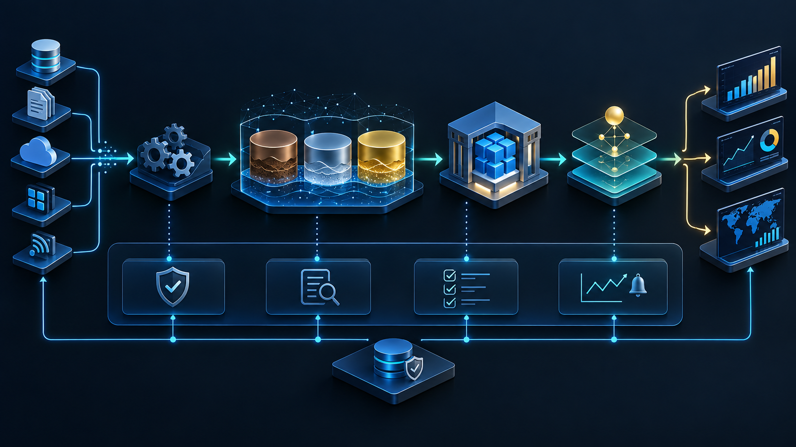
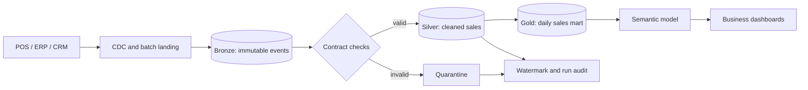

# Retail Lakehouse with CDC

> A reproducible, incremental retail pipeline that turns point-of-sale changes into a governed daily sales mart.



## What this project demonstrates

- CDC ingestion with deterministic de-duplication and a persisted watermark
- Bronze, Silver and Gold data products with a quarantine path for bad events
- Reconciliation between valid source events and the Gold daily sales mart
- Run-level audit data suitable for orchestration, alerting and operational review

## Architecture



## Quick start

```bash
python -m retail_lakehouse --output runtime
python -m unittest discover -s tests -v
```

The sample run writes JSON artefacts to `runtime/`: Bronze input, Silver records, quarantined events, a Gold daily-sales mart and a run audit.

## Design choices

| Concern | Implementation |
| --- | --- |
| Idempotency | Event IDs are de-duplicated before transformation. |
| Late data | Each accepted event is ordered by its business timestamp before aggregation. |
| Data quality | Required fields, allowed operations and positive amounts are enforced. |
| Recovery | Invalid events are retained in quarantine with a reason. |
| Reconciliation | Gold revenue must equal the sum of accepted sales events. |

## Production mapping

This local reference implementation maps cleanly to Azure Data Factory or Airflow for scheduling, object storage for Bronze, Spark or SQL transformations for Silver/Gold, and a BI semantic model over the Gold mart. See [architecture notes](docs/architecture.md) and the [data contract](docs/data-contract.md).

## Repository layout

```text
retail_lakehouse/     Executable pipeline
tests/                Contract and reconciliation tests
docs/                 Architecture and operating guidance
assets/               README architecture visual
```
